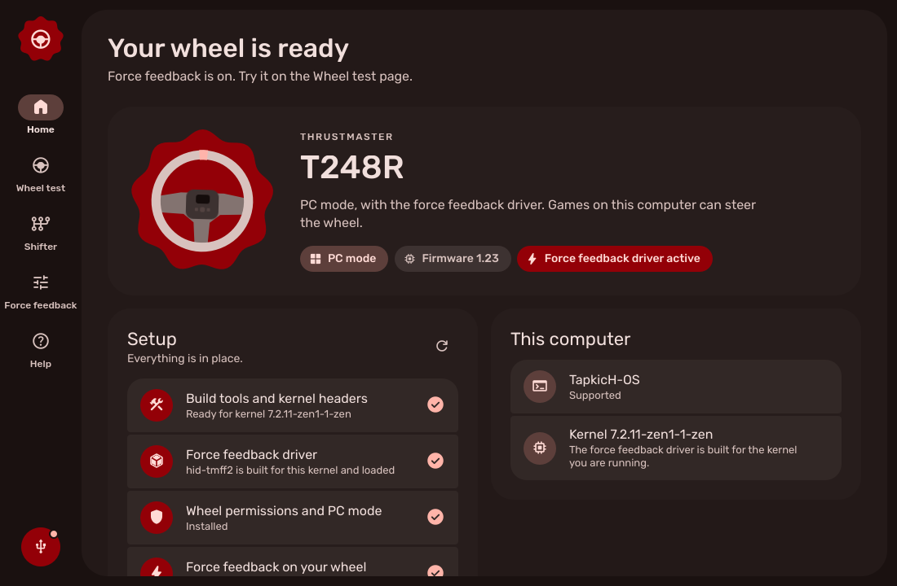
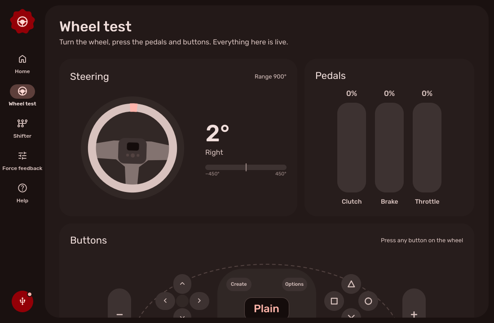
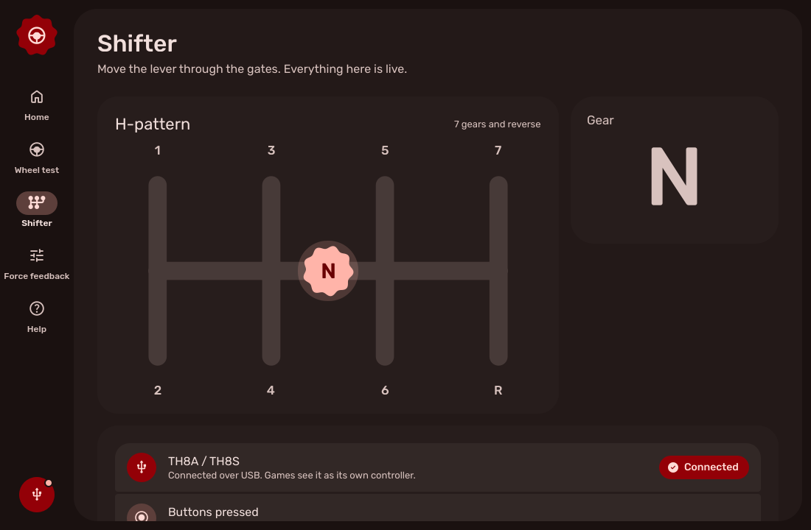

# My Linux T248R Panel

My Linux T248R Panel sets up a Thrustmaster T248R racing wheel on Linux in one click, then lets you test and tune it. It also shows your TH8A or TH8S shifter.

Out of the box, Linux treats the T248R as a plain controller. Steering, pedals and buttons work, but games get no force feedback. This app installs the right driver, fixes the permissions, puts the wheel in PC mode and keeps it that way.

  

  
  

|  | Plain Linux | With the panel |
|---|---|---|
| Force feedback | None. The generic driver can't do it | The hid-tmff2 driver, built for your kernel |
| Kernel updates | You rebuild the driver by hand | DKMS rebuilds it for you |
| PlayStation mode | The wheel shows up as a T300RS and the buttons get mixed up | Switched to PC mode on its own, like the Windows driver does |
| Permissions | Some games can't see the wheel | Rules for the wheel and the shifter |
| Settings | Edit files by hand | Rotation presets like on the wheel (180°, 360°, 540°, 900°), strength, spring, damper and friction |
| Testing | `evtest` in a terminal | Live steering, pedals, buttons, shifter and force feedback tests |
| Colours | | Material 3, and it follows your Caelestia colours if you use Caelestia |

> [!NOTE]
> Made and tested for the T248R. A plain T248 in PC mode should work too, but it hasn't been tested. Shifters only work plugged into the PC by USB.

## Install

Download the package for your distro from the [Releases](https://github.com/Tapuuk/my-linux-t248r-panel/releases) page, then install it from the folder you saved it to.

| Distro | Command |
|---|---|
| Arch, CachyOS, EndeavourOS, Manjaro | `sudo pacman -U ./my-linux-t248r-panel-*.pkg.tar.zst` |
| Debian 13, Ubuntu 25.04 or newer, Mint, Pop!_OS | `sudo apt install ./my-linux-t248r-panel_*_all.deb` |
| Fedora, Nobara | `sudo dnf install ./my-linux-t248r-panel-*.noarch.rpm` |
| openSUSE Tumbleweed | `sudo zypper install ./my-linux-t248r-panel-*.noarch.rpm` |

Ubuntu 24.04, Mint 22 and Debian 12 don't have PySide6 in their repositories. On those, the app downloads it once the first time you open it (about 150 MB).

## Set up your wheel

1. Plug the T248R into a USB port on the PC and switch it on.
2. Open My Linux T248R Panel from your app menu.
3. Click **Set up everything** and type your password when asked. The first run takes a few minutes, because it installs the build tools and builds the driver.
4. Go to **Wheel test** and click **Pull left**. If the wheel turns on its own, you're done.

If your wheel is in PlayStation mode, the panel switches it to PC mode. You can also do it on the wheel: press MODE, pick the green PC MODE with the D-pad and press MODE again.

If the driver won't load and Secure Boot is on, the panel shows the command to enroll the signing key. Run it, reboot and pick **Enroll MOK** on the blue screen.

## In games

- **Steam:** if a game sees the wheel but has no force feedback, open the game's properties and turn off Steam Input.
- **Buttons work but no force feedback:** turn on **Keep the wheel awake** on the Force feedback page. The wheel's fan keeps running while it's plugged in.
- **Test first:** if the force feedback test in the panel works, the driver is fine and the problem is in the game or Proton.
- **Rotation:** leave the wheel's own rotation setting on AUTO, then pick the angle in the panel. A fixed angle set on the wheel overrides the panel.

## Help with Windows

If you also use the wheel on Windows and My Thrustmaster Panel stops seeing it, the **Help** page has Thrustmaster's recovery steps written out, so you don't have to look them up again.

## Remove it

**Help → Undo everything** removes the driver, the rules and the saved settings. Then uninstall the package as usual.

## Credits

- [hid-tmff2](https://github.com/Kimplul/hid-tmff2) by Kimplul, the Linux force feedback driver that does the real work
- [Caelestia shell](https://github.com/caelestia-dots/shell) by the caelestia-dots project, for the look
- [Material Symbols](https://github.com/google/material-design-icons) and the [Rubik](https://github.com/googlefonts/rubik) font
- [Qt for Python (PySide6)](https://doc.qt.io/qtforpython-6/) and [python-evdev](https://github.com/gvalkov/python-evdev)

## Licences

Our own code in this repository is MIT (see LICENSE). Everything else keeps its own licence:

- **hid-tmff2** is GPL-2.0. It isn't included here. The panel downloads a fixed version from its GitHub page during setup and builds it on your PC.
- **Fonts** in `t248rpanel/assets/fonts`: Rubik is under the SIL Open Font License 1.1, Material Symbols is under the Apache License 2.0. Their licence files sit next to them.

Thrustmaster and T248R are trademarks of Guillemot Corporation S.A. This project isn't made or supported by Thrustmaster.
